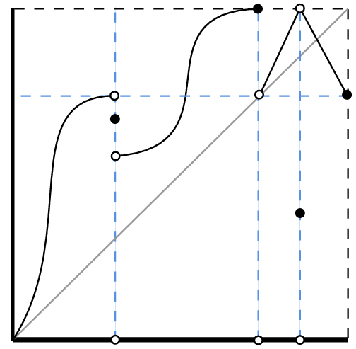

<figure>
  
  <figcaption>Graph of a piecewise continuous map with four continuity pieces with a positive entropy greater than or equal to $\log 2$.</figcaption>
</figure>

**Abstract.** We generalize the definition of topological entropy given by Adler, Konheim, and McAndrew (AKM) for piecewise continuous self-maps defined on a compact interval (pc-maps). For this notion of entropy, we prove that the properties of the AKM-entropy in the compact-continuous setting get naturally extended, including that it can be estimated using Bowen’s formula disregarding the metric used to compute it. Additionally, for piecewise strictly monotonic pc-maps, we prove that the Misiurewicz-Szlenk formula based on the asymptotic behavior of the number of monotony pieces for iterations of the map coincides with our notion of topological entropy. In this way, we unify the notions of entropy commonly used for piecewise continuous interval maps, proving that they all coincide under compactness assumptions.